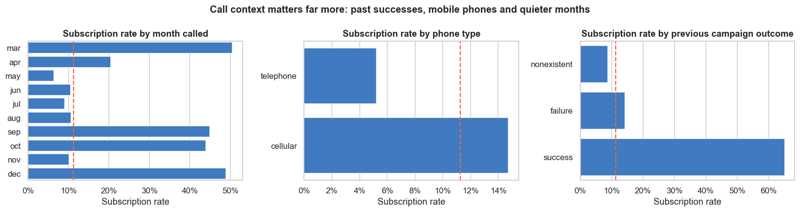
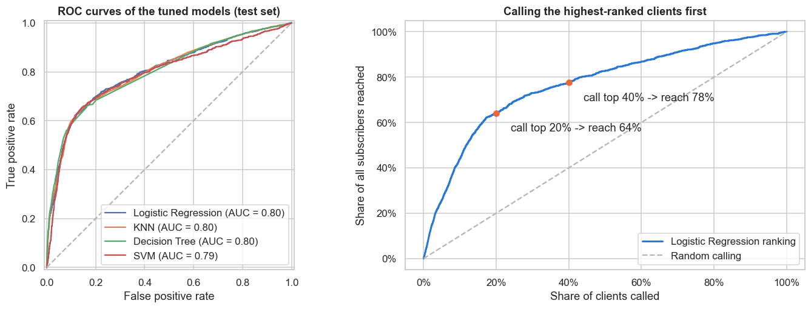
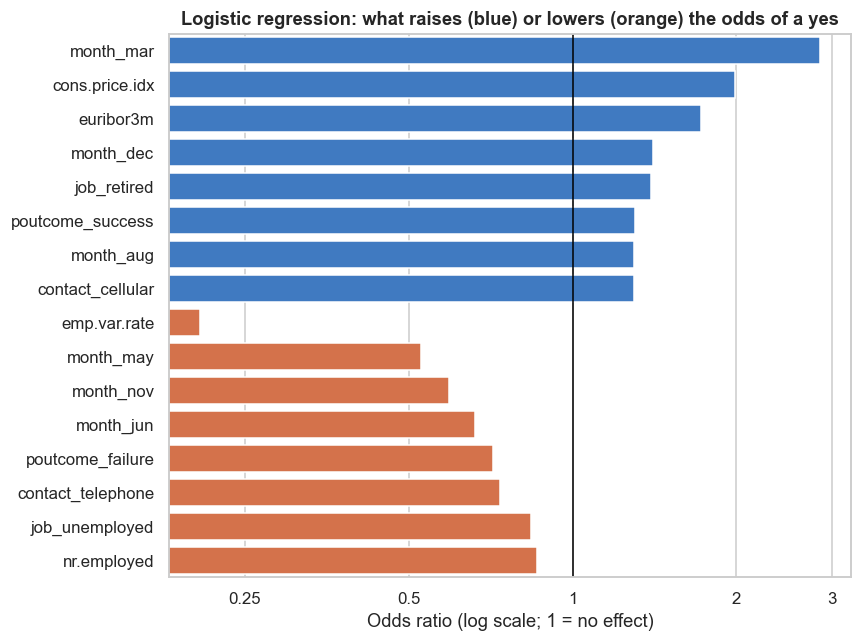

# Which Bank Clients Will Say Yes? Comparing Classifiers

Practical Application III for the UC Berkeley Professional Certificate in Machine Learning & Artificial Intelligence.

**Full analysis:** [comparing_classifiers.ipynb](comparing_classifiers.ipynb)

## The question

A Portuguese bank sells term deposits by phone. Only about **1 call in 9** ends in a subscription, so most calls are wasted. The goal is to predict, **before a call is made**, which clients are most likely to say yes, so the call centre can phone them first, and to compare four classifiers for the job: k-nearest neighbors, logistic regression, decision tree and support vector machine.

## The data

41,188 calls from **17 telemarketing campaigns** run between May 2008 and November 2010 ([UCI Bank Marketing dataset](https://archive.ics.uci.edu/dataset/222/bank+marketing)), with client details, call details, past contact history and five economic indicators. Twelve duplicate rows were removed. Call `duration` was left out of every model because it is only known after the call has ended.

## How the models were judged

Accuracy is misleading here: a "model" that answers *no* for everyone is 89% accurate and finds no subscribers. The bank's real decision is **who to call first**, so models were compared on **ROC AUC** (how well they rank likely subscribers above unlikely ones; 0.5 = guessing, 1.0 = perfect), with recall and precision as supporting measures.

## Results

| Model | Default settings, client features only (test ROC AUC) | Tuned with grid search, all pre-call features (test ROC AUC) | Fit time (default) |
|---|---|---|---|
| Logistic Regression | 0.65 | **0.80** | 0.1 s |
| KNN | 0.59 | 0.80 | 0.05 s |
| Decision Tree | 0.58 | 0.80 | 0.3 s |
| SVM | 0.59 | 0.79 | 54 s |

- With client details alone, every model was no more accurate than always saying no.
- Adding the call context and economic data mattered more than the choice of model; once tuned with 5-fold cross-validation, all four rank clients about equally well.
- **Logistic regression is the recommended model:** marginally the best, the fastest, and easy to explain.

## Findings

- **Ranking works.** Calling the top-ranked 20% of clients first reaches **64% of all subscribers**, with a success rate of 36%, **3.2 times** the 11% of calling at random.
- **Timing and the economy matter most.** Clients subscribed far more often when employment was falling and interest rates were low (2009-2010). March, September, October and December calls succeeded 44-51% of the time; May, the busiest month, only 6%.
- **Past subscribers are the best prospects:** 65% of clients who said yes in a previous campaign said yes again, against 9% of new contacts.
- **Mobile beats landline:** calls to mobile phones had about 1.75 times the odds of success.
- **Repeated calls have diminishing returns:** the success rate falls from 13% on the first call to 6% by the fifth.
- **Retirees and students** are the most likely to subscribe; **housing and personal loans make no difference**.

## Actionable recommendations

- Score every client before a campaign and **call the highest-ranked first**.
- **Call previous subscribers first** and **prefer mobile numbers**.
- **Stop after two or three calls** to the same client in a campaign.
- **Time large campaigns with the economic cycle** rather than running the biggest pushes when deposits are least attractive.
- Don't target by loan status, which makes no difference.

## Next steps

- Agree with the business how many clients to call per campaign, using the cost of a call and the value of a deposit.
- Test the model on later campaigns than those it was trained on, since the economy changed a lot over 2008-2010.
- Try ensemble models (random forest, gradient boosting).
- Run a pilot: half a campaign called by model ranking, half as usual, and compare subscriptions per call.

## Repository contents

| Path | What it is |
|---|---|
| `comparing_classifiers.ipynb` | The full analysis: data understanding, statistics, the four classifiers, tuning, findings |
| `data/bank-additional-full.csv` | The bank marketing data (UCI) |
| `data/bank-additional-names.txt` | Description of every column |
| `images/` | Charts used in this README, saved by the notebook |
| `requirements.txt` | Python libraries needed to run the notebook |

To run it: `pip install -r requirements.txt`, then open `comparing_classifiers.ipynb` in Jupyter and run all cells (about 3 minutes).
